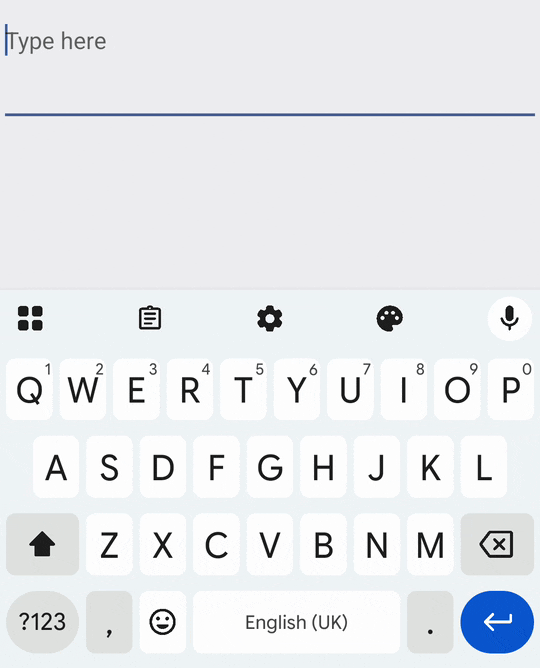

# pboard

A privacy preserving Gboard alternative.



Gboard types well, but it is a Google app that can reach the internet. The open-source keyboards can't, but they
type noticeably worse. pboard is an attempt at both: it looks and behaves like Gboard, and it has no network access at
all.

## What you get

- Autocorrect, next-word prediction and glide typing, with models that run on the phone.
- It learns your words as you type. You can also import your personal dictionary from a Gboard export.
- Emoji with search, clipboard history, one-handed mode, a customisable toolbar.
- Light, dark, Material You and colour themes.
- Voice typing, translation (German, Spanish, French) and scan-text, each as an optional offline add-on.

## What you don't

- Any language other than English (UK and US). This is the big one, and it is next.
- GIF and sticker search. They need the internet, so they are not coming.
- Anything Gboard learned about your typing. Only the personal dictionary can be brought over.

## Privacy

pboard does not request the `INTERNET` permission, and the build fails if a network permission ever shows up in the
manifest. There are no analytics and no accounts. What it learns stays in app-private storage, is left out of Android
backups, and is never learned from password fields or fields that ask for no personalisation.

It asks for two permissions, both optional: the microphone for voice typing, and contacts if you turn on "Suggest
contact names" (off by default; names are kept in memory only).

## How good is the typing

Measured against Gboard 18.6 by replaying the same recorded human typing through both keyboards, top-1 word accuracy:

| Test set | pboard | Gboard |
|---|---|---|
| Glide typing (FUTO swipe set) | 92.8% | 86.0% |
| Glide typing (How We Swipe) | 79.3% | 75.8% |
| Tapping (VTAP) | 95.8% | 96.2% |
| Tapping (TSI) | 93.1% | 92.4% |

So: ahead on glide typing, level on tapping. The harness is in `tools/bench` and the method in `docs/bench/README.md`.
Benchmarks are not daily use, and Gboard has had years of polish that these numbers don't capture. Bug reports about
places where it feels worse are welcome.

## Install

Download `pboard-<version>.apk` from [Releases](https://github.com/Ahmad-A0/pboard/releases), or add this repository to
[Obtainium](https://obtainium.imranr.dev/) to get updates. Then enable pboard under Settings › System › Keyboard.

The add-ons are the other APKs on the release page. pboard can't download them itself, so you install the ones you
want by hand:

| File | Adds | Size |
|---|---|---|
| `pboard-voice-en` | Voice typing | 174 MB |
| `pboard-voice-en-accurate` | Voice typing, slower and more accurate | 132 MB |
| `pboard-translate-de` / `-es` / `-fr` | Translation to and from English | about 50 MB each |
| `pboard-scan` | Scan text from a photo | 9 MB |

## Build

```
nix develop --command ./gradlew :app:assembleDebug
nix develop --command ./gradlew :engine:test :translate:test :app:testDebugUnitTest
```

The Nix flake provides the Android SDK and JDK 17. Without Nix, use JDK 17 and an Android SDK with platform 36 and
build-tools 37. [CONTRIBUTING.md](CONTRIBUTING.md) covers the module layout and the rules for contributions.

## Licence

Code is [MIT](LICENSE). The parts ported from AOSP stay Apache-2.0, and the language model data is CC BY-SA 4.0
because of the corpora it was built from. [NOTICE](NOTICE) has the details.
